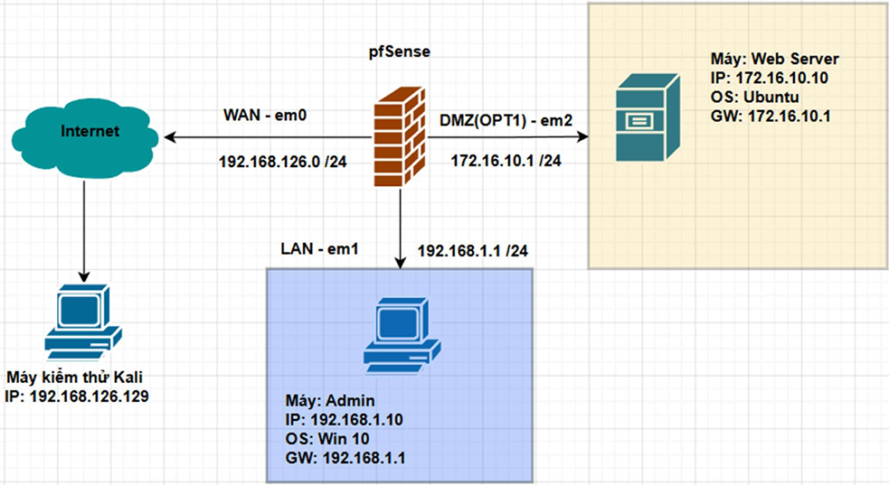
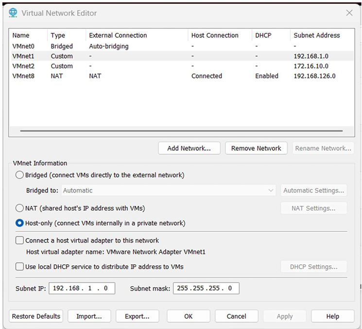
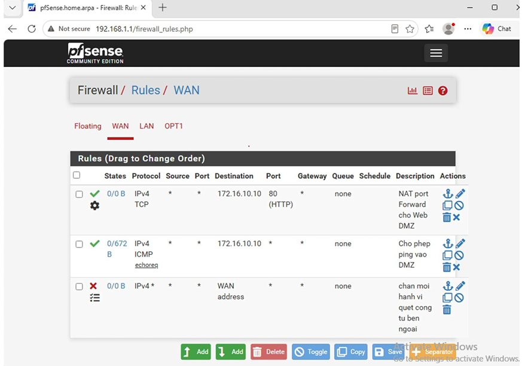
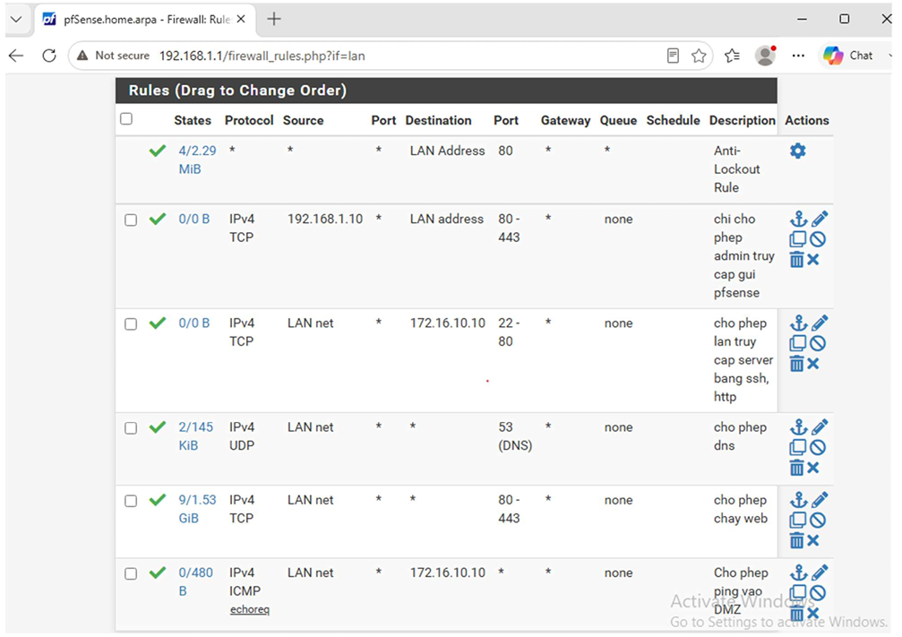
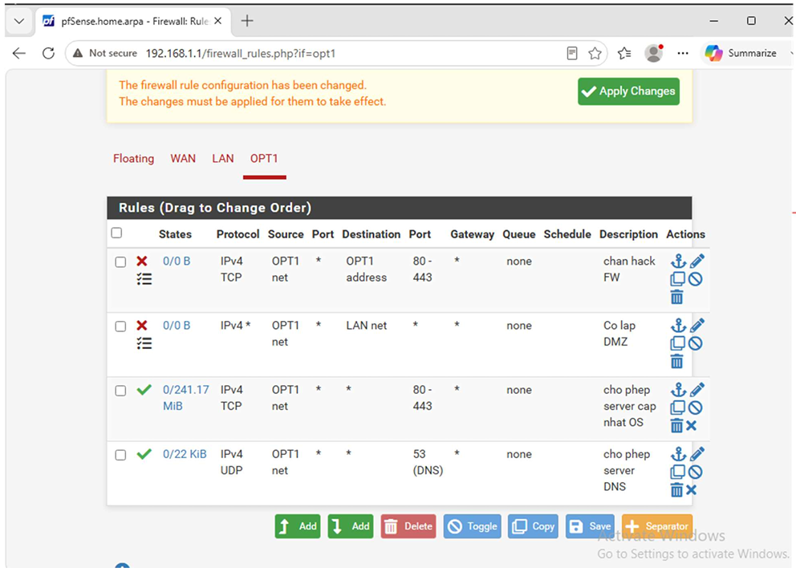
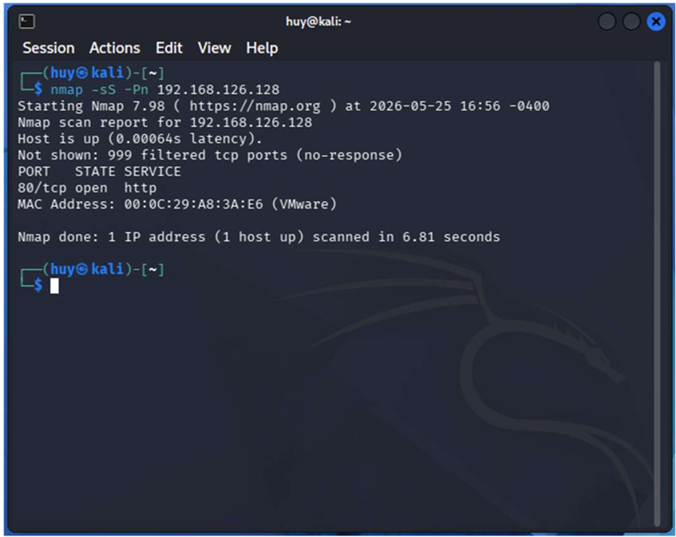
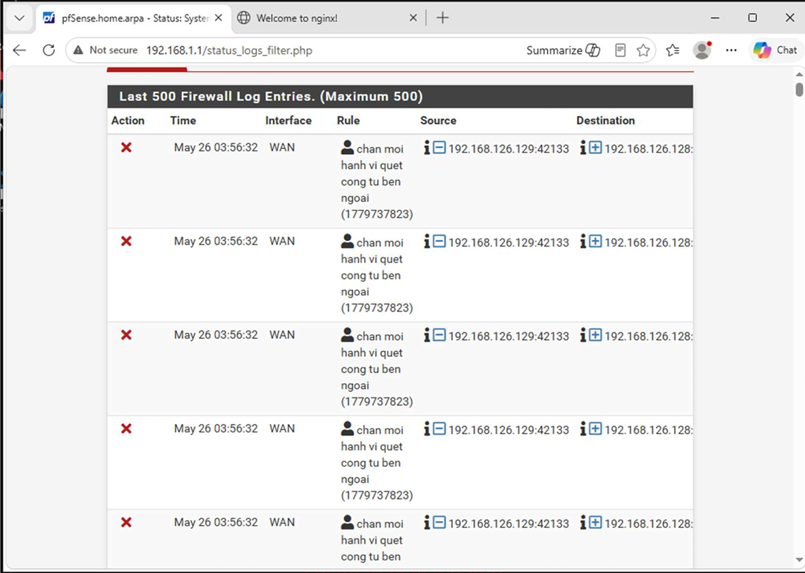
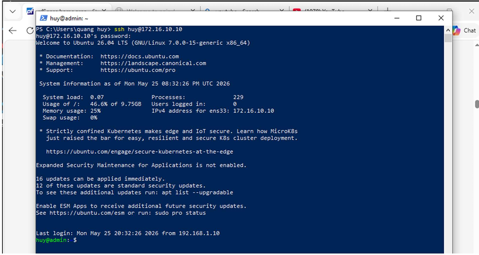
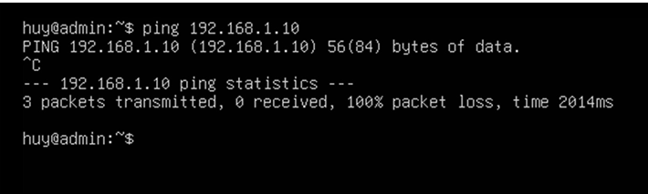
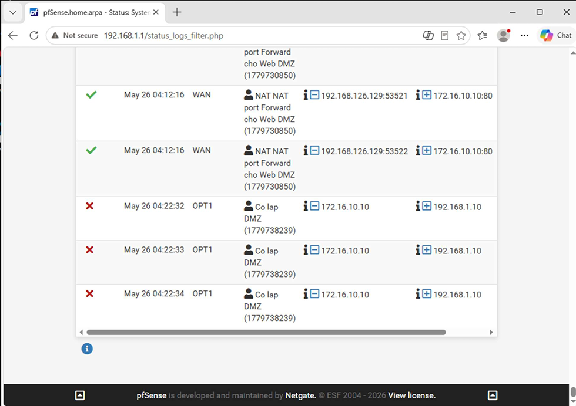

# Lab tường lửa pfSense: mô hình phân vùng WAN / LAN / DMZ

Bài thực hành nhóm môn An ninh mạng (Đại học Thủy Lợi).
Phụ trách thiết kế và triển khai hệ thống (mô hình mạng, cấu hình pfSense, kịch bản kiểm thử).

## Tóm tắt
- Thiết kế mạng 3 vùng (WAN, LAN, DMZ) với pfSense 2.7.0 trên VMware Workstation
- Xây dựng chính sách theo nguyên tắc Default Deny, cấu hình NAT port forward và giới hạn kết nối
- Kiểm thử bằng Nmap từ Kali: chặn quét cổng, cô lập DMZ khỏi LAN, xác minh qua firewall log

## 1. Sơ đồ mạng

| Thiết bị | Interface | Địa chỉ IP | Gateway |
|---|---|---|---|
| pfSense | WAN (em0) | 192.168.126.128/24 | VMnet8 |
| pfSense | LAN (em1) | 192.168.1.1/24 | |
| pfSense | DMZ (em2) | 172.16.10.1/24 | |
| Admin (Windows 10) | LAN | 192.168.1.10/24 | 192.168.1.1 |
| Web Server (Ubuntu) | DMZ | 172.16.10.10/24 | 172.16.10.1 |
| Kali (attacker) | WAN | 192.168.126.129/24 | 192.168.126.128 |

Các vùng mạng được tạo bằng Virtual Network Editor của VMware:

## 2. Chính sách an ninh (Default Deny)
| Nguồn | Đích | Cổng | Hành động | Mục đích |
|---|---|---|---|---|
| WAN (Kali) | Web Server (DMZ) | 80/TCP | Pass (NAT) | Cho phép truy cập web từ Internet |
| WAN | WAN address | Any | Block & Log | Chặn và ghi log quét cổng |
| LAN (Admin) | Web Server (DMZ) | 22, 80 | Pass | Quản trị Web Server |
| LAN | Any | 53, 80, 443 | Pass | Duyệt web và phân giải DNS |
| DMZ | LAN | Any | Block & Log | Chống di chuyển ngang |
| DMZ | DMZ address | 80, 443 | Block | Bảo vệ WebGUI của firewall |
| DMZ | Any | 53, 80, 443 | Pass | Server tải bản vá |

## 3. Luật đã cấu hình

## 4. Kiểm thử

**Test 1: Quét cổng từ Kali** (`nmap -sS -Pn 192.168.126.128`)

Chỉ cổng 80 mở, 999 cổng còn lại bị filtered. Luật chặn trên WAN ghi log các gói bị loại.

**Test 2: Quản trị từ máy Admin**

Admin SSH được tới Web Server.

**Test 3: Giả lập Web Server bị chiếm quyền**

Từ Ubuntu (DMZ) ping sang Admin (LAN): mất 100% gói, log ghi nhận luật cô lập DMZ.

## 5. Bài học rút ra
- **Thứ tự luật:** pfSense xử lý từ trên xuống và dừng ở luật khớp đầu tiên, nên luật cụ thể (như cô lập DMZ) phải đặt trước luật chung.
- **Whitelist thay vì Blacklist:** mặc định từ chối, chỉ mở những gì thật sự cần.
- **Ghi log có chọn lọc:** chỉ bật log ở luật quan trọng (chặn WAN, cô lập DMZ) để tránh nhiễu khi phân tích.
- **Phòng thủ nhiều lớp:** giả định Web Server có thể bị chiếm, nên cần cô lập DMZ khỏi LAN.

## 6. Hạn chế và hướng cải thiện
- Một số luật đang dùng **dải cổng** (ví dụ 22-80, 80-443) nên mở rộng hơn cần thiết. Cách đúng là tạo alias liệt kê từng cổng riêng.
- Chưa triển khai IDS/IPS (Suricata/Snort), mới dừng ở mức tìm hiểu lý thuyết.
- Chưa có giám sát tập trung (dự định thử Zabbix).